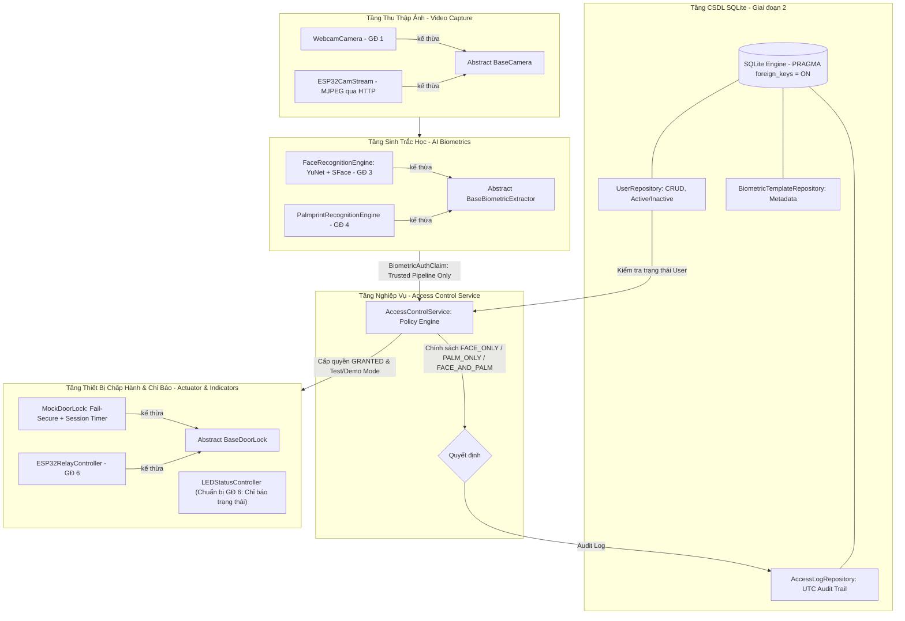
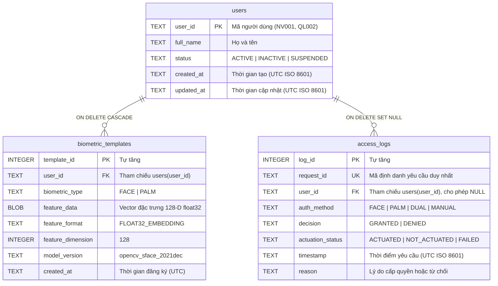

# SmartDoorLock: Hệ Thống Khóa Cửa Thông Minh Sinh Trắc Học (Face & Palmprint)

> **Đề tài bài tập lớn môn IoT và Ứng dụng:**  
> *Ứng dụng ESP32-S3-CAM OV2640 xác thực khuôn mặt và lòng bàn tay để mở khóa cửa.*

---

## 1. Giới thiệu tổng quan

Dự án phát triển hệ thống kiểm soát ra vào cửa thông minh bằng cách kết hợp hai phương thức sinh trắc học không tiếp xúc: **Nhận diện khuôn mặt (Face Recognition)** và **Nhận diện lòng bàn tay (Palmprint Recognition)**.

### Mục tiêu thiết kế
- **Độc lập phần cứng (Hardware Agnostic):** Trong các giai đoạn đầu, hệ thống chạy trực tiếp trên máy tính sử dụng **Laptop Webcam** và **Khóa cửa giả lập (Mock Door Lock)**. Toàn bộ logic xử lý ảnh, CSDL và điều khiển chấp hành được trừu tượng hóa, sẵn sàng tích hợp **ESP32-S3-CAM OV2640** và **Relay 5V / Khóa điện tử 12V** mà không phải sửa đổi tầng nghiệp vụ AI.
- **Tách biệt quyết định cấp quyền và điều khiển khóa (Decoupled Policy & Actuation):** Tầng nghiệp vụ chỉ ra quyết định cấp quyền (`GRANTED`/`DENIED`) dựa trên chính sách bảo mật đa nhân tố. Việc kích hoạt khóa vật lý (`ACTUATED`/`NOT_ACTUATED`/`FAILED`) được kiểm soát chặt chẽ trong môi trường xác minh, không tạo API mở khóa công khai.
- **Bảo mật và an toàn (Fail-Secure Principle):**
  - Mặc định khóa luôn ở trạng thái logic `LOCKED`. Mọi lỗi logic phát sinh trong quá trình nhận diện hoặc sự cố phần mềm đều giữ nguyên trạng thái khóa, ngăn chặn mở cửa trái phép.
  - *Lưu ý về phạm vi phần cứng:* Lớp `MockDoorLock` mô phỏng logic an toàn trong phần mềm; tính năng duy trì trạng thái khóa cơ học khi mất điện lưới thực tế là đặc tính của phần cứng khóa điện tử 12V dạng thường đóng (Fail-Secure Solenoid / Dropbolt) sẽ được tích hợp ở Giai đoạn 6.
- **Chính trực học thuật:** Không sử dụng các module AI giả mạo (hardcoded `return True`). Các module sinh trắc học chưa triển khai (như Palmprint) đều ném ngoại lệ `NotImplementedError` một cách minh bạch.

---

## 2. Kiến trúc phần mềm (Software Architecture)

Hệ thống được thiết kế theo mô hình kiến trúc phân tầng (Layered Architecture) và tuân thủ các nguyên lý **SOLID**:



> [!NOTE]
> **Định hướng mở rộng thiết bị ngoại vi (LED Indicator):** Đèn LED thông báo trạng thái hệ thống được quy hoạch thuộc Tầng Thiết bị Chấp Hành (Hardware Layer) ở Giai đoạn 6. Do chưa xác định chủng loại phần cứng cụ thể, thiết kế tuân thủ nguyên lý phân tách trách nhiệm (Separation of Concerns): Tầng Sinh trắc học (AI Biometrics) hoàn toàn độc lập với thiết bị hiển thị/chấp hành, đảm bảo khi tích hợp `LEDStatusController` (GPIO/màu sắc/hiệu ứng) sẽ không phải sửa đổi bất kỳ thuật toán AI nào.

---

## 3. Tầng Nhận diện Khuôn mặt AI (Giai đoạn 3: YuNet + SFace)

Hệ thống tích hợp trực tiếp 2 mô hình mạng nơ-ron tích chập (CNN) chính thức từ kho **OpenCV Zoo** chạy trên OpenCV DNN:

1. **Phát hiện khuôn mặt (YuNet - `face_detection_yunet_2023mar.onnx`):**
   - Kích thước siêu nhẹ (~230 KB), kiến trúc tối ưu cho Edge CPU.
   - Xác định Bounding Box và **5 điểm mốc Landmark** (mắt phải, mắt trái, chóp mũi, khóe miệng phải, khóe miệng trái).
   - Tự động thay đổi kích thước đầu vào động theo độ phân giải khung hình webcam (640x480).
2. **Căn chỉnh và Trích xuất đặc trưng (SFace - `face_recognition_sface_2021dec.onnx`):**
   - Căn chỉnh xoay 5 điểm mốc bằng phương thức chính thức `cv2.FaceRecognizerSF.alignCrop()` để đưa khuôn mặt về chuẩn $112 \times 112$ px.
   - Trích xuất vector đặc trưng không gian cầu 128 chiều (`np.float32`), chuẩn hóa $L_2$ ($\|v\|_2 = 1.0$).
3. **So khớp Cosine Similarity:**
   $$\text{Similarity}(\mathbf{u}, \mathbf{v}) = \frac{\mathbf{u} \cdot \mathbf{v}}{\|\mathbf{u}\|_2 \|\mathbf{v}\|_2} = \sum_{i=1}^{128} u_i v_i$$
   - Ngưỡng cấu hình mặc định: **$0.60$** (có thể tinh chỉnh qua CLI `--threshold`).
   - Ngưỡng đánh giá độ tin cậy: $\ge 0.75$ (Rất cao), $\ge 0.60$ (Đạt), $< 0.60$ (Từ chối).

### Kiểm tra tính toàn vẹn mô hình (SHA-256):
- `face_detection_yunet_2023mar.onnx`: `8F2383E4DD3CFBB4553EA8718107FC0423210DC964F9F4280604804ED2552FA4`
- `face_recognition_sface_2021dec.onnx`: `0BA9FBFA01B5270C96627C4EF784DA859931E02F04419C829E83484087C34E79`

### Kết quả đo thực nghiệm hiệu năng trên Laptop CPU (Thực tế, không ước tính):
- **Thời gian phát hiện khuôn mặt (YuNet 640x480):** `16.15 ms`
- **Thời gian trích xuất vector đặc trưng (SFace 112x112):** `20.46 ms`
- **Tổng độ trễ suy luận AI trên 1 khuôn mặt:** `36.61 ms`
- **Tốc độ xử lý khung hình liên tục:** **`27.3 FPS`** trên CPU thông thường.

---

## 4. Thiết kế Cơ sở dữ liệu SQLite

Hệ thống sử dụng SQLite với cấu hình bắt buộc `PRAGMA foreign_keys = ON;` trên mọi kết nối để đảm bảo tính toàn vẹn tham chiếu. Toàn bộ mốc thời gian đều được chuẩn hóa theo định dạng **UTC ISO 8601**.



---

## 5. Quy trình Đăng ký & Nhận diện Khuôn mặt

### A. Đăng ký mẫu khuôn mặt (`scripts/enroll_face.py`)
1. Kiểm tra tài khoản người dùng có tồn tại trong CSDL và có trạng thái `ACTIVE` hay không.
2. Bật webcam, phân tích chất lượng ảnh thời gian thực:
   - **Quy tắc duy nhất:** Bắt buộc có đúng 1 khuôn mặt (0 mặt hoặc $>1$ mặt đều bị từ chối).
   - **Độ sáng:** Cường độ trung bình phải nằm trong khoảng $[35.0, 230.0]$.
   - **Độ nét (Sharpness):** Phương sai toán tử Laplacian $\ge 40.0$ (loại bỏ ảnh nhòe, chuyển động nhanh).
   - **Kích thước:** Bounding box tối thiểu $60 \times 60$ px.
3. Thu thập **5 mẫu hợp lệ** ở các góc nghiêng nhẹ và thời điểm khác nhau (cách nhau tối thiểu 0.8s).
4. Tính trung bình cộng vector 5 mẫu để khử nhiễu, chuẩn hóa $L_2$ và lưu dưới dạng byte blob vào bảng `biometric_templates`. Không lưu ảnh gốc nhằm bảo vệ quyền riêng tư.

### B. Nhận diện mở cửa trực tiếp (`scripts/demo_face_unlock.py`)
1. Quét frame từ webcam, phát hiện khuôn mặt và 5 điểm mốc qua YuNet.
2. Trích xuất vector 128 chiều qua SFace, tính Cosine Similarity với tất cả các mẫu trong CSDL.
3. Nếu điểm cao nhất $\ge$ Threshold (0.60):
   - Đóng gói đối tượng `BiometricAuthClaim(is_trusted_source=True)`.
   - Gửi yêu cầu qua `AccessControlService(policy=AuthPolicy.FACE_ONLY)`.
   - Nếu được cấp quyền: HUD hiển thị viền xanh lá + Họ tên người dùng + Điểm số tương đồng; `MockDoorLock` chuyển sang `UNLOCKED` và tự động khóa lại sau 4s.
4. Nếu người lạ hoặc điểm $< 0.60$:
   - HUD hiển thị viền đỏ + `ACCESS DENIED: Unknown Face`. **Tuyệt đối không hiển thị tên người dùng** khi chưa đạt ngưỡng tin cậy.

---

## 6. Hướng dẫn vận hành & Kiểm thử

### Cài đặt từ bản clone GitHub

Dùng Python 3.11, mở PowerShell ở thư mục dự án và chạy:

```powershell
py -3.11 -m venv .venv
.\.venv\Scripts\python.exe -m pip install -r requirements.txt
.\.venv\Scripts\python.exe scripts/download_models.py
.\.venv\Scripts\python.exe scripts/prepare_account_admin_demo.py --empty
```

Sau đó khởi động FastAPI và Streamlit theo hướng dẫn bên dưới. Tạo tài khoản và đăng ký mẫu thử mới trên dashboard.

### Bước 1: Kích hoạt môi trường ảo
```powershell
.\.venv\Scripts\Activate.ps1
```

### Bước 2: Tải trọng số mô hình YuNet & SFace (nếu cài đặt mới)
```powershell
.\.venv\Scripts\python.exe scripts/download_models.py
```

### Bước 3: Chạy bộ kiểm thử

```powershell
.\.venv\Scripts\python.exe -m pytest -s -q
```

**Kết quả kiểm thử bản demo hiện tại:** **120 bài kiểm thử đạt**.

### Bước 4: Khởi động demo trên máy tính

Từ thư mục dự án, nếu chưa có `data/account_admin_demo.sqlite3`, tạo SQLite demo dùng chung:

```powershell
if (-not (Test-Path '.\data\account_admin_demo.sqlite3')) {
    .\.venv\Scripts\python.exe scripts/prepare_account_admin_demo.py --empty
}
```

Mở hai cửa sổ PowerShell tại thư mục dự án. Khởi động FastAPI ở cửa sổ thứ nhất:

```powershell
$env:SMARTDOORLOCK_ADMIN_DB = (Resolve-Path '.\data\account_admin_demo.sqlite3').Path
.\.venv\Scripts\python.exe -m uvicorn src.api.main:app --host 127.0.0.1 --port 8000
```

Khởi động Streamlit ở cửa sổ thứ hai:

```powershell
$env:SMARTDOORLOCK_API_URL = 'http://127.0.0.1:8000'
.\.venv\Scripts\python.exe -m streamlit run src/ui/dashboard.py --server.address 127.0.0.1 --server.port 8501
```

Giữ cả hai cửa sổ chạy, rồi mở [dashboard](http://127.0.0.1:8501/).

1. Trong **Người dùng**, tạo hoặc chọn tài khoản đang hoạt động. Vào **Đăng ký sinh trắc học**, chọn khuôn mặt, lòng bàn tay trái hoặc lòng bàn tay phải. Trong cửa sổ webcam, nhấn **Space** mỗi khi mẫu sẵn sàng cho đến khi đủ 5 mẫu.
2. Trong **Thử mở khóa**, chọn **Khuôn mặt** (`FACE_ONLY`), **Lòng bàn tay** (`PALM_ONLY`) hoặc **Khuôn mặt + lòng bàn tay** (`FACE_AND_PALM`). Nhấn **Bắt đầu xác thực**, rồi nhấn **Space** cho từng mẫu sẵn sàng. Ở chế độ kép, đưa mặt trước và lòng bàn tay sau. Hai yếu tố phải khớp cùng tài khoản trong cùng phiên.
3. Đối chiếu mã yêu cầu trong thẻ kết quả với **Lịch sử xác thực**. Để thử hết hạn, chọn chế độ kép rồi chờ đồng hồ về 0 khi chưa thu đủ mẫu. Kết quả mong đợi là `DENIED / NOT_ACTUATED`, có lý do hết hạn và cùng mã yêu cầu trong lịch sử.

---

### Thử hai nguồn camera trong cùng buổi demo

Trong **Thử mở khóa**, nguồn mặc định là **Webcam máy tính**. Với **ESP32-CAM**, nhập URL luồng HTTP MJPEG dùng IPv4 nội bộ, ví dụ `http://192.168.1.50:81/stream`. Bấm **Kiểm tra hình ảnh** để xem một khung hình, sau đó đóng tab xem stream trực tiếp nếu đang mở để bo rảnh phục vụ dashboard. Chọn một trong ba chế độ xác thực và bấm **Bắt đầu xác thực**. Khi có lỗi kết nối hoặc ảnh không đạt chất lượng, chọn lại **Webcam máy tính** và bắt đầu lần thử mới. Cả hai nguồn dùng khóa giả lập. Đăng ký mẫu vẫn dùng webcam máy tính.

**Bàn giao ESP32-CAM OV2640**

1. Kiểm tra chữ in ở mặt sau bo và đối chiếu sơ đồ chân của đúng model. Các ảnh cửa hàng chỉ gợi ý kiểu bo ESP32-CAM. Sketch `scripts/esp32_camera/esp32_camera.ino` giả định pinout **AI Thinker ESP32-CAM** (ESP32 đời thường, OV2640). Nếu bo khác, dùng cấu hình Arduino và pinout đúng model trong [ví dụ chính thức Espressif](https://github.com/espressif/arduino-esp32/tree/master/libraries/ESP32/examples/Camera/CameraWebServer).
2. Mở sketch trong Arduino IDE đã cài gói **esp32 by Espressif Systems** (bản 3.x). Chọn **AI Thinker ESP32-CAM** nếu đã xác nhận đúng bo, cắm đế USB bằng cáp dữ liệu và chọn cổng COM. Điền SSID/mật khẩu Wi-Fi 2,4 GHz trong bản sketch cục bộ. Đặt máy tính và camera trên cùng mạng cho phép các thiết bị liên lạc với nhau.
3. Nạp sketch. Nếu đế USB không tự vào chế độ nạp, giữ IO0 ở mức thấp khi reset để nạp, sau đó nhả IO0 và reset lại. Mở Serial Monitor ở 115200 và sao chép URL in sau `Stream:`.
4. Mở URL trên trình duyệt máy tính, xem rõ khuôn mặt và lòng bàn tay rồi đóng tab stream. Dán URL vào dashboard, thử **Kiểm tra hình ảnh**, sau đó chạy từng chế độ với người và bên tay đã đăng ký. Đối chiếu kết quả và bản ghi lịch sử. Thử ngắt camera giữa hai bước của chế độ kép để kiểm tra lần thử bị từ chối, rồi chuyển về webcam và thử lại. Giữ luồng camera trên mạng demo nội bộ.

## 7. Các giới hạn bảo mật quan trọng

1. **Chưa có Anti-Spoofing / Liveness Detection:** Hệ thống hiện sử dụng luồng ảnh 2D RGB thông thường. Các cuộc tấn công trình chiếu (Presentation Attack) bằng ảnh in trên giấy hoặc màn hình điện thoại có thể đánh lừa mô hình 2D nếu không có thêm cảm biến chiều sâu (IR/Depth) hoặc thuật toán phát hiện chớp mắt/cử động đầu.
2. **Khóa cửa vật lý:** Giai đoạn 3 sử dụng `MockDoorLock` để xác minh luồng điều khiển trong môi trường kiểm thử/demo. Tuyệt đối không tự ý đấu nối mở khóa vật lý khi chưa có mạch bảo vệ và relay ở Giai đoạn 6.

---

## 8. Lộ trình triển khai các giai đoạn tiếp theo

| Giai đoạn | Nội dung công việc | Trạng thái |
| :---: | :--- | :---: |
| **Giai đoạn 1** | Thiết lập môi trường Python 3.11, kiến trúc phân tầng, `WebcamCamera`, `MockDoorLock` session timer, 23 unit tests. | **Hoàn thành** |
| **Giai đoạn 2** | Xây dựng CSDL SQLite (3 bảng chuẩn), Repository DAOs, Quản trị người dùng, Chính sách `FACE_ONLY`, `PALM_ONLY`, `FACE_AND_PALM`, 43 unit tests. | **Hoàn thành** |
| **Giai đoạn 3** | Tích hợp thuật toán nhận diện khuôn mặt thật (OpenCV YuNet + SFace), đăng ký mẫu 5 frame, demo nhận diện live HUD, đạt 62 unit tests. | **Hoàn thành** |
| **Giai đoạn 4** | Nhận diện lòng bàn tay thật (`PalmprintRecognitionEngine`) & xác thực kép `FACE_AND_PALM`. | Đã triển khai cho demo local |
| **Giai đoạn 5** | REST API và dashboard Streamlit, gồm quản lý tài khoản trên SQLite thử nghiệm dùng chung với demo webcam. | Đã triển khai cho demo local |
| **Giai đoạn 6** | Tích hợp phần cứng: ESP32-S3-CAM OV2640, mạch Relay 5V / Khóa điện tử 12V, và thiết bị hiển thị trạng thái (`LEDStatusController` - thiết kế độc lập, chưa gắn cứng GPIO/màu sắc). | Dự kiến |
